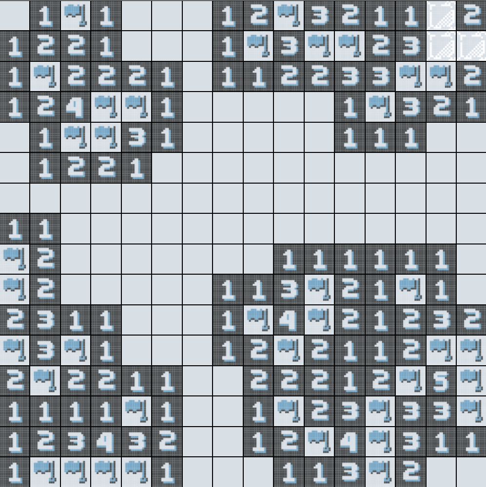

  

# Minesweeper in C++

A custom C++ implementation of the classic Minesweeper game, using sprites one of my friends made! This project was useful to test my knowledge on graphs, recursion and interactive gameplay mechanics.

## Features

- **Menu and stop option:** Allows the player to enjoy the game with no pressure, or to reset it.
- **Difficulty levels:** Progression done by field size and number of mines.
- **Win / Loss Detection:** Checks win conditions upon each safe move and reveals all mines upon hit. Will play sound effects and show a smiley or a frowney face! :)
